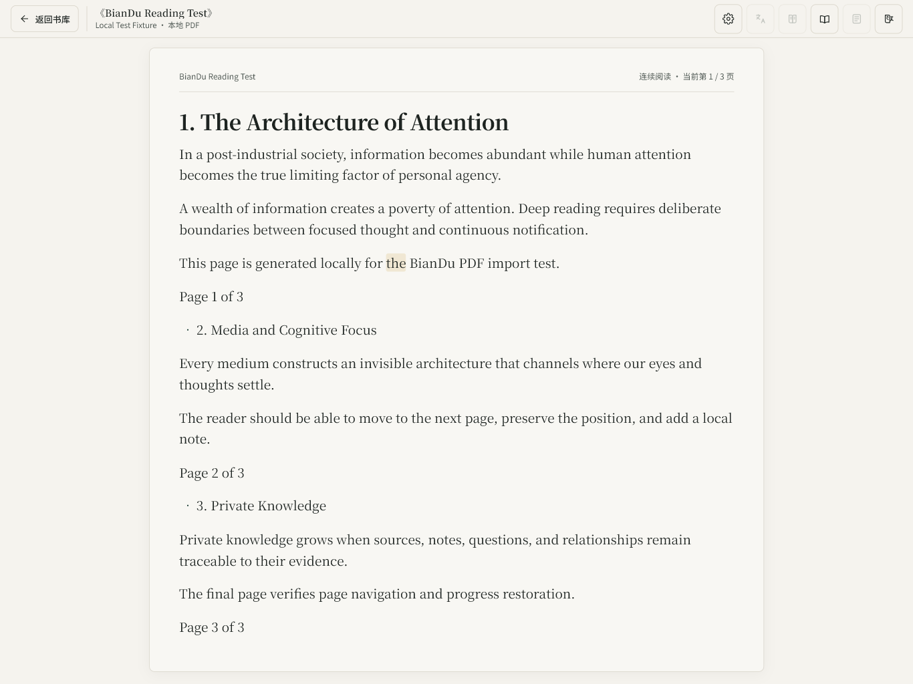
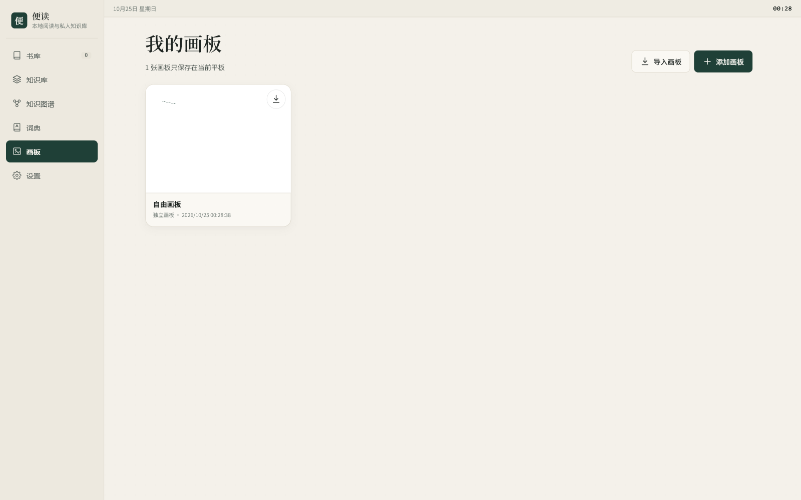
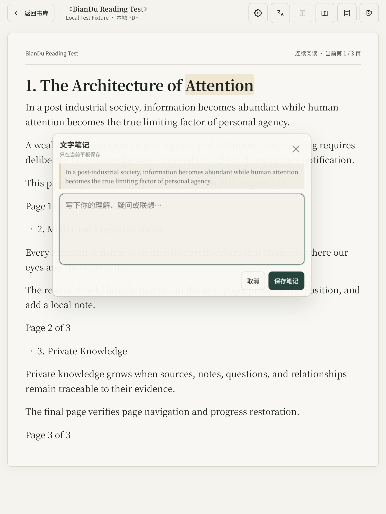

<div align="center">
  
  <h1>便读</h1>
  <h3>本地优先的平板阅读、手写笔记与知识库</h3>
  <p><em>把 PDF 阅读、翻译、词典、画板和可追溯 AI 知识库放进同一台平板</em></p>
  
  
  
  
</div>

## 项目介绍

便读是为长期阅读和私人研究设计的平板应用。它可以导入本地 PDF，在重排文字与原始版面之间切换，并在阅读过程中完成翻译、查词、文字笔记、手写批注和知识整理。

书籍、笔记、画板、词典、知识节点与 API Key 默认只保存在当前设备。AI 功能通过用户自行配置的 OpenAI 兼容模型工作，不要求注册账号或上传整套书库。

小米 Pad 使用 Capacitor Android 应用，iPad 使用部署到 HTTPS 的 PWA。两端共享业务代码，但数据完全独立，不做自动同步。

## 核心能力

| 模块 | 能力 |
| --- | --- |
| 阅读 | PDF 导入、连续文字阅读、原页视图、页面快照、阅读位置恢复、字体与版面设置 |
| 语言 | 整书逐页翻译、暂停与继续、选句翻译、语境词典、自动去重与本地保存 |
| 手写 | 全屏无限画板、钢笔/铅笔/荧光笔/橡皮/套索、压感、倾斜、掌托隔离、PDF 原页批注 |
| 知识库 | 本地证据索引、BGE-M3 语义检索、引用校验、知识图谱、可追溯 AI 问答 |
| 交付 | 阅读中是原位笔记浮层；画板支持完整文件导入导出、PDF 和 PNG 导出 |
| 安全 | 本地优先存储、AES-GCM 加密 API Key、备份合并保护、原文七天清理保护 |

完整功能清单见 [docs/features.md](docs/features.md)。

## 界面预览

| 我的画板 | 阅读中做笔记 |
| --- | --- |
|  |  |

阅读器采用连续文字流，保留 PDF 原页入口；画板编辑器使用全屏画布和右侧工具轨道。

## 快速开始

### Android 平板

```powershell
npm install
npm run android:sync
cd android
.\gradlew.bat assembleRelease
```

Release APK 输出到 `android/app/build/outputs/apk/release/app-release.apk`。正式发布使用本机签名，签名文件不会进入 Git。

### iPad PWA

```powershell
npm install
npm run build:web
```

将 `www/` 部署到 HTTPS 静态站点，在 Safari 中打开后选择“添加到主屏幕”。iPad 必须始终使用同一个域名和路径，否则会被视为另一套本地数据。

本地开发可运行：

```powershell
npm start
```

打开 `http://127.0.0.1:4173`。PDF、IndexedDB 和 Service Worker 需要通过 localhost 或 HTTPS 使用。

## 文档导航

| 文档 | 内容 |
| --- | --- |
| [功能详情](docs/features.md) | 阅读、翻译、词典、画板、知识库、模型与数据安全的完整能力清单 |
| [架构说明](docs/architecture.md) | 模块划分、数据流与本地优先设计 |
| [产品规格](docs/product-spec.md) | 产品目标、交互边界与验收条件 |
| [安装与数据说明](docs/release-install.md) | Android/iPad 安装、备份和数据边界 |
| [设计系统](DESIGN.md) | 平板布局、颜色、排版、组件与响应式规范 |

## 开发与测试

```powershell
npm test
npm run test:full
npm run test:pen
npm run test:orientation
npm run test:models
npm run test:storage
```

测试覆盖 PDF 导入与排版、阅读与翻译、词典、画板与小米笔事件、知识库引用、存储事务、备份恢复、横竖屏和离线 PWA。

## 项目结构

```text
index.html                 应用壳、页面与设计系统
features.js                PDF 导入、本地数据与阅读交互
runtime.css                组件样式
src/web/reader.js          阅读、翻译与 PDF 原页批注
src/web/board.js           画板、笔迹、导入导出与 PDF 生成
src/web/knowledge-*.js     证据检索、知识编译与知识库 Agent
src/web/deepseek.js        OpenAI 兼容模型与多模型绑定
android/                   Capacitor Android 工程
vendor/pdfjs/              离线 PDF.js 资源
tests/                     单元、端到端、笔、存储与模型测试
```

## API Key 与数据安全

- 仓库不包含真实 API Key、`.env`、本地模型配置、签名库或服务器私钥。
- API Key 由用户在当前平板填写，并使用 AES-GCM 加密保存在本机 IndexedDB。
- 完整备份不包含 API Key；两台平板之间没有自动同步。
- `src/web/builtin-models.generated.js`、`config/*.local.json`、`keystore.properties`、签名文件、构建目录、截图和测试输出均被 `.gitignore` 排除。
- 测试文件只使用明确标注的 `test-only-dummy-key-*` 无效占位值。

## 当前边界

- 有文字层的 PDF 可直接重排和建立知识证据；扫描页需要 OCR，识别后应人工校对。
- 需要保留照片、图表、公式和原始版式时，应使用永久保存的原页视图。
- 手写识别、OCR 与 AI 回答可能出错，原始 PDF、笔迹和用户笔记不会被识别结果覆盖。
- 真实 AI 质量取决于用户配置的接口与模型。连接测试不会把失败显示成成功。
- 小米笔的最终压感曲线、笔键事件码与掌托体验仍需在实体平板上验收。
